# Contributing guidelines

## Contribution rules

We encourage you to use AI tools for coding help, but pull request descriptions and issues MUST be written in your own words. We need to understand what you changed, why you changed it, and how you verified it without having to review a large AI-generated explanation.

Open a discussion before starting changes that affect project direction, for examples:

- Adding or replacing dependencies.
- Changing authentication, installation, packaging, PAM, or application flows.
- Introducing a new feature or changing existing behavior.
- Large refactors that make behavior hard to review.

The discussion should explain the problem, the proposed solution, expected impact, and any distro-specific risks. Pull requests without clear evidence for the change may be closed.

AI-like issues or pull requests, including generic generated text, vague impact statements, or submissions that do not show personal understanding of the change, will be closed as not planned.

## Review flow

Review is a stack of layers, not one gate. Each layer catches what the others miss, and the cheap ones run first so human time goes to what only humans can judge.

| # | Layer | Where | Blocks merge? |
| --- | --- | --- | --- |
| 1 | Verification: run the checks, show the output | Your machine | Yes (no evidence, no review) |
| 2 | AI code review against [REVIEW.md](REVIEW.md) with fresh context | Your machine (`/pre-pr`) | Yes (findings must be resolved) |
| 3 | Security review for high-risk paths | Your machine (`/pre-pr` → `/security-review`) | Yes |
| 4 | Mechanical checks: Biome, tsc, clang-format, rustfmt, clippy, tests, build | GitHub CI | Yes |
| 5 | Human approval, scaled by risk | GitHub, [CODEOWNERS](.github/CODEOWNERS) | Yes |
| 6 | Revert and fix forward | After merge | — |

All AI review runs locally. GitHub CI only runs the mechanical checks.

### 1. Before the pull request

- **Show, don't claim.** Run the commands for the areas you touched (table in [CLAUDE.md](CLAUDE.md#verify-before-saying-done)) and paste the output in the PR's Verification section. For camera, fingerprint, or PAM behavior, include what you tested on (distro, device, VM) and logs or screenshots.
- **Run `/pre-pr`** if you use Claude Code. It runs the checks, has a fresh-context subagent review the diff against REVIEW.md, and runs `/security-review` when the diff touches high-risk paths. If you use another tool, do the same steps by hand: verify, then have a reviewer that did not write the code read the diff against REVIEW.md.
- **Fix or answer every Important finding.** Fix it, or write down why it does not apply. Pre-existing findings don't block your PR, but open an issue for real ones.
- **Keep review rounds bounded.** After the first round, re-review only the new changes. After 3 rounds on the same change, stop and rethink the approach instead of looping.
- **Keep changes small.** Small PRs are easier to review, debug, and revert.

The project's [Claude Code hook](.claude/settings.json) and [lefthook](lefthook.yml) run formatters automatically, so formatting never needs review comments.

### 2. On the pull request

Fill in the [PR template](.github/PULL_REQUEST_TEMPLATE.md) yourself. Its **Verification**, **Risk**, and **How to revert** sections are what reviewers check first. An AI tool may help you collect facts, but you are responsible for every line.

Pick the risk tier from what the change touches, not from who wrote it:

| Tier | Examples | Review needed |
| --- | --- | --- |
| Low | Docs, UI copy, styling, tests | Green CI and one maintainer approval |
| Medium | App logic, Tauri commands, face/fingerprint pipeline | Green CI, `/pre-pr` report, one maintainer approval |
| High | `auth/pam`, `auth/core`, install/remove scripts, PAM config, packaging, `.github/` | Green CI, `/pre-pr` with security review, code owner approval, tested in a VM |

High-risk paths are listed in [CODEOWNERS](.github/CODEOWNERS) and always need a human code owner. Bot or agent approvals never count as the required approval. If you push new commits after approval, the reviewer re-checks them. All review threads must be resolved, either fixed or closed with a short reason, before merge.

If you ran an agent that wrote the PR, you are its author: you answer review comments and you own the result.

### 3. After merge

- **You land it, you own it.** If your change causes a regression, you are expected to help fix or revert it. This is about context, not blame.
- **Revert first, debug second.** If a merged change breaks login, packaging, or install, revert it and investigate on a branch.
- **Feed misses back.** When a bug gets past review, or the reviewer flags the same issue twice, add a one-line entry to REVIEW.md's "Recurring issues", or fix it at the source with a lint rule, a check, or a CLAUDE.md note.

### What humans review

Automation handles routine bugs and style. Humans focus on:

- **Should we build this?** Direction, scope, and fit, which is why discussions come before large changes.
- **Dangerous code.** PAM, root-run scripts, packaging, CI and release workflows.
- **Architecture** that sets conventions others will follow.
- **Evidence.** Does the test output, log, or screenshot actually show what the PR claims?

To learn an unfamiliar part of the codebase before changing it, ask your AI tool for an explainer of that exact module. It is a faster way to build context than reading old diffs.

## 1. How to Run

Biopass consists of a backend C++ authentication module and a frontend Tauri desktop application. You will need to install dependencies for both.

### Install Dependencies

**For the C++ Backend:**

You need to install CMake, Make, PAM headers, CLI11, libjpeg-turbo, and the build tools libcamera needs.

```bash
sudo apt update
sudo apt install cmake make g++ pkg-config libpam0g-dev libcli11-dev libturbojpeg0-dev \
  meson ninja-build python3-jinja2 python3-yaml python3-ply  libudev-dev libdrm-dev \
  libegl-dev libgles-dev
```

**For the Tauri Application:**

You need to install [Bun](https://bun.sh/), Rust/Cargo, and system UI dependencies.
```bash
# Install Bun
curl -fsSL https://bun.sh/install | bash

# Install Rust
curl --proto '=https' --tlsv1.2 -sSf https://sh.rustup.rs | sh

# Install Tauri prerequisites (Ubuntu/Debian)
sudo apt install libwebkit2gtk-4.1-dev build-essential curl wget file libxdo-dev libssl-dev libayatana-appindicator3-dev librsvg2-dev
```

### Building the Project

The root directory includes a `Makefile` that orchestrates the entire build process.

To build the C++ backend (`auth` module):
```bash
make build-auth
```

To build both the C++ backend and the Tauri frontend:
```bash
make build
```

To package the application into Linux release artifacts (`.deb` and `.rpm`)
```bash
make package
```

### Running the Desktop App in Dev Mode

To run the Tauri app locally with hot module replacement (HMR), use the following commands:
```bash
cd app
bun install
bun run tauri dev
```

## 2. Tech Stack

### Backend Authentication Module (`auth/`)
- **C++17**
- **CMake**
- **libcamera**: built from source at a pinned version and bundled into the package (see
  `auth/BundleLibcamera.cmake`) instead of linked against the system's copy, since libcamera's C++ ABI
  breaks across minor versions.
- **ONNX Runtime**: runs the machine learning models (YOLO for detection, EdgeFace for recognition, MobileNetV3 for anti-spoofing).
- **Linux PAM**

### Desktop Application (`app/`)
- **Tauri v2**
- **Rust**
- **Vite & React**
- **TypeScript**
- **TailwindCSS**

## 3. Architecture and Flow

```mermaid
sequenceDiagram
    participant OS as Linux Login/Sudo (PAM)
    participant Lib as libbiopass_pam.so
    participant Helper as biopass-helper
    participant Sensors as Camera/Mic/Fingerprint
    participant TauriBackend as Tauri Rust Backend
    participant ReactUI as React Frontend

    rect rgb(30, 41, 59)
    Note over OS,Sensors: Backend Authentication Flow
    OS->>Lib: Authenticate User
    Lib->>Helper: Spawn Isolated Process
    Helper->>Sensors: Capture Biometrics
    Sensors-->>Helper: Return Data
    Helper->>Helper: Run Local Inference
    Helper-->>Lib: Return Exit Code (0 for Success)
    Lib-->>OS: PAM_SUCCESS or PAM_AUTH_ERR
    end

    rect rgb(31, 41, 55)
    Note over TauriBackend,ReactUI: Desktop Management Flow
    ReactUI->>TauriBackend: Update Config/Register Biometrics
    TauriBackend->>Sensors: Capture Biometrics
    Sensors-->>TauriBackend: Return Reference Data
    TauriBackend-->>ReactUI: Save to ~/.../config.yaml
    end
```

The Biopass system is split into two primary layers: **The Backend Authentication Module** and the **Desktop UI Engine**.



### Directory Structure

```text
biopass/
├── app/                  # The Tauri Desktop Application
│   ├── src/              # React frontend (Vite + TypeScript + Tailwind)
│   ├── src-tauri/        # Rust backend bridging system calls and the UI
│   └── tauri.conf.json   # Configuration for the desktop bundle
│
├── auth/                 # The C++ Backend Authentication Module
│   ├── core/             # Shared classes (logging, config parsing)
│   ├── face/             # Implementation of the face auth module (Yolo, EdgeFace, MobileNetV3)
│   ├── fingerprint/      # Implementation of the fingerprint auth module
│   ├── pam/              # PAM module integration logic (`libbiopass_pam.so` and `biopass-helper`)
│   └── CMakeLists.txt    # Build orchestration for the auth module
│
├── docs/                 # Documentation (Contributing, Architecture)
└── Makefile              # Root build orchestrator (calls CMake and Tauri build commands)
```

## 4. Development Warnings and Debugging

When you need to modify the C++ PAM logic, we recommend you enable the `debug` flag in the configuration. You may open the UI app and toggle **Debug Mode** to ON, or manually edit `~/.config/com.ticklab.biopass/config.yaml`. When the debug flag is enabled, detailed logs are printed, and face captures that fail authentication (or get caught spoofing) are saved as `.bmp` images to `~/.local/share/com.ticklab.biopass/debugs/`.

### ⚠️ System Lockout Warnings

Editing your distro PAM include file (typically `/etc/pam.d/common-auth` on Debian/Ubuntu or `/etc/pam.d/system-auth` on Fedora) incorrectly may **lock you out of your system permanently**. Be extremely careful when manually testing new PAM libraries. Use one of the following methods to prevent lockout:

- Use a Virtual Machine: It is strongly recommended to use a Linux VM (e.g QEMU + KVM) for development. This allows you to take snapshot rollbacks if a module crashes or corrupts the PAM stack. Notice that fingerprint devices usually cannot be passed through to a virtual machine.
- Grant write permission to the PAM file you are testing, for example: `sudo chown $USER:root /etc/pam.d/common-auth` and `sudo chmod 644 /etc/pam.d/common-auth`.
- Rescue USB: Use a rescue USB to mount the filesystem and manually fix the configuration files if you accidentally reboot into a locked system.
