# Contributing guidelines

## Contribution rules

AI tools are welcome for code, issues, and PR descriptions, as long as the result follows the [issue forms](.github/ISSUE_TEMPLATE) and the [PR template](.github/PULL_REQUEST_TEMPLATE.md): short, factual, with real evidence. You are responsible for everything you submit.

Open a discussion before changes that affect project direction, for example:

- Adding or replacing dependencies.
- Changing authentication, installation, packaging, PAM, or application flows.
- Introducing a new feature or changing existing behavior.
- Large refactors that make behavior hard to review.

The discussion should cover the problem, proposed solution, expected impact, and distro-specific risks.

Issues or PRs that skip the template, claim results without output, or pad the description with generic text will be closed as not planned.

## Review flow

Review is a stack of layers. Cheap ones run first so human time goes to what only humans can judge.

| # | Layer | Where | Blocks merge? |
| --- | --- | --- | --- |
| 1 | Verification: run the checks, show the output | Your machine | Yes (no evidence, no review) |
| 2 | AI code review against [REVIEW.md](REVIEW.md) with fresh context | Your machine (`/pre-pr`) | Yes (findings must be resolved) |
| 3 | Security review for high-risk paths | Your machine (`/pre-pr` → `/security-review`) | Yes |
| 4 | Mechanical checks: Biome, tsc, clang-format, rustfmt, clippy, tests, build | GitHub CI | Yes |
| 5 | Human approval, scaled by risk | GitHub, [CODEOWNERS](.github/CODEOWNERS) | Yes |
| 6 | Revert and fix forward | After merge | — |

All AI review runs locally. GitHub CI only runs the mechanical checks.

### 1. Before the pull request

- **Show, don't claim.** Run the commands for the areas you touched (table in [CLAUDE.md](CLAUDE.md#verify-before-saying-done)) and paste the output in the PR's Verification section. For camera, fingerprint, or PAM behavior, include what you tested on (distro, device, VM) and logs or screenshots.
- **Run `/pre-pr`** (Claude Code). It runs the checks, has a fresh-context subagent review the diff against REVIEW.md, and runs `/security-review` for high-risk paths. With other tools, do the same by hand: verify, then have a reviewer that did not write the code read the diff against REVIEW.md.
- **Fix or answer every Important finding.** Pre-existing findings don't block your PR, but open an issue for real ones.
- **Keep review rounds bounded.** After the first round, re-review only new changes. After 3 rounds, rethink the approach.
- **Keep changes small.** Easier to review, debug, and revert.

The [Claude Code hook](.claude/settings.json) and [lefthook](lefthook.yml) run formatters automatically, so formatting never needs review comments.

### 2. On the pull request

Fill in the [PR template](.github/PULL_REQUEST_TEMPLATE.md) (`/pre-pr` drafts it; read it before opening the PR). Reviewers check **Verification**, **Review report**, **Risk**, and **How to revert** first, so those must hold real output and facts.

Pick the risk tier from what the change touches:

| Tier | Examples | Review needed |
| --- | --- | --- |
| Low | Docs, UI copy, styling, tests | Green CI and one maintainer approval |
| Medium | App logic, Tauri commands, face/fingerprint pipeline | Green CI, `/pre-pr` report, one maintainer approval |
| High | `auth/pam`, `auth/core`, install/remove scripts, PAM config, packaging, `.github/` | Green CI, `/pre-pr` with security review, code owner approval, tested in a VM |

High-risk paths are listed in [CODEOWNERS](.github/CODEOWNERS) and always need a human code owner; bot or agent approvals never count. Commits pushed after approval get re-checked. All review threads must be resolved (fixed, or closed with a short reason) before merge.

If an agent wrote your PR, you are still its author: you answer review comments and own the result.

### 3. After merge

- **You land it, you own it.** Help fix or revert regressions your change causes.
- **Revert first, debug second.** If a merged change breaks login, packaging, or install, revert it and investigate on a branch.
- **Feed misses back.** When a bug gets past review, or the same issue is flagged twice, add a line to REVIEW.md's "Recurring issues", or fix it at the source (lint rule, check, or CLAUDE.md note).

### What humans review

Automation handles routine bugs and style. Humans focus on:

- **Should we build this?** Direction, scope, and fit.
- **Dangerous code.** PAM, root-run scripts, packaging, CI and release workflows.
- **Architecture** that sets conventions others will follow.
- **Evidence.** Does the output, log, or screenshot actually show what the PR claims?

## 1. How to Run

### Install Dependencies

**C++ backend** (CMake, PAM headers, CLI11, libjpeg-turbo, and libcamera's build tools):

```bash
sudo apt update
sudo apt install cmake make g++ pkg-config libpam0g-dev libcli11-dev libturbojpeg0-dev \
  meson ninja-build python3-jinja2 python3-yaml python3-ply  libudev-dev libdrm-dev \
  libegl-dev libgles-dev
```

**Tauri app** ([Bun](https://bun.sh/), Rust, and system UI libraries):

```bash
# Install Bun
curl -fsSL https://bun.sh/install | bash

# Install Rust
curl --proto '=https' --tlsv1.2 -sSf https://sh.rustup.rs | sh

# Install Tauri prerequisites (Ubuntu/Debian)
sudo apt install libwebkit2gtk-4.1-dev build-essential curl wget file libxdo-dev libssl-dev libayatana-appindicator3-dev librsvg2-dev
```

### Build

```bash
make build-auth   # C++ backend (auth/)
make build        # backend + Tauri app
make package      # .deb and .rpm
```

### Run the app in dev mode (HMR)

```bash
cd app
bun install
bun run tauri dev
```

## 2. Tech Stack

- **`auth/`**: C++17, CMake, Linux PAM, ONNX Runtime (YOLO detection, EdgeFace recognition, MobileNetV3/MiniFASv2 anti-spoofing), libcamera. libcamera is built from source at a pinned version and bundled (`auth/BundleLibcamera.cmake`) because its C++ ABI breaks across minor versions.
- **`app/`**: Tauri v2, Rust, Vite, React, TypeScript, TailwindCSS.

## 3. Architecture and Flow

```mermaid
sequenceDiagram
    participant OS as Linux Login/Sudo (PAM)
    participant Lib as libbiopass_pam.so
    participant Helper as biopass-helper
    participant Sensors as Camera/Mic/Fingerprint
    participant TauriBackend as Tauri Rust Backend
    participant ReactUI as React Frontend

    rect rgb(30, 41, 59)
    Note over OS,Sensors: Backend Authentication Flow
    OS->>Lib: Authenticate User
    Lib->>Helper: Spawn Isolated Process
    Helper->>Sensors: Capture Biometrics
    Sensors-->>Helper: Return Data
    Helper->>Helper: Run Local Inference
    Helper-->>Lib: Return Exit Code (0 for Success)
    Lib-->>OS: PAM_SUCCESS or PAM_AUTH_ERR
    end

    rect rgb(31, 41, 55)
    Note over TauriBackend,ReactUI: Desktop Management Flow
    ReactUI->>TauriBackend: Update Config/Register Biometrics
    TauriBackend->>Sensors: Capture Biometrics
    Sensors-->>TauriBackend: Return Reference Data
    TauriBackend-->>ReactUI: Save to ~/.../config.yaml
    end
```



### Directory Structure

```text
biopass/
├── app/                  # The Tauri Desktop Application
│   ├── src/              # React frontend (Vite + TypeScript + Tailwind)
│   └── src-tauri/        # Rust backend; tauri.conf.json bundle config
│
├── auth/                 # The C++ Backend Authentication Module
│   ├── core/             # Shared classes (logging, config parsing)
│   ├── face/             # Face auth (detection, recognition, anti-spoofing)
│   ├── fingerprint/      # Fingerprint auth
│   ├── pam/              # libbiopass_pam.so and biopass-helper
│   └── CMakeLists.txt
│
├── docs/                 # PAM, Polkit, IR camera, keyring guides
└── Makefile              # Root build (CMake + Tauri)
```

### Config schema and generated files

`app/src-tauri/src/config.rs` is the source of truth for `config.yaml`. `cargo test` checks these committed files and fails when one is out of date; regenerate them with `BIOPASS_UPDATE_GENERATED=1 cargo test` in `app/src-tauri` and commit the result:

- `app/src/bindings.ts`: TypeScript types, typed commands and `CONFIG_LIMITS` (specta, tauri-specta). Don't edit it by hand.
- `auth/test/config/defaults.yaml` and `limits.yaml`: the `config_golden` ctest checks the helper reads the same defaults and ranges (`auth/core/auth_config.h`). The C++ structs are still hand-written; change both sides.

## 4. Development Warnings and Debugging

When changing C++ auth logic, enable **Debug Mode** in the app (or the `debug` flag in `~/.config/com.ticklab.biopass/config.yaml`). It prints detailed logs and saves failed or spoof-flagged face captures as `.bmp` to `~/.local/share/com.ticklab.biopass/debugs/`.

### ⚠️ System Lockout Warnings

Editing your distro PAM include file (typically `/etc/pam.d/common-auth` on Debian/Ubuntu, `/etc/pam.d/system-auth` on Fedora) incorrectly can **lock you out of your system permanently**. To stay safe:

- **Use a VM** (strongly recommended, e.g. QEMU + KVM) so you can roll back snapshots if a module crashes or corrupts the PAM stack. Fingerprint readers usually can't be passed through to a VM.
- **Edit PAM files as root with `sudoedit`** (e.g. `sudoedit /etc/pam.d/common-auth`) and keep them owned by root. Never `chown` them to your user: whoever can write a PAM file can make `sudo` let them in without a password.
- **Open a root shell before you edit** (`sudo -i` in another terminal; `sudo` itself goes through PAM) and keep it open while you test, so you can revert a broken change without authenticating again.
- **Keep a rescue USB** to mount the filesystem and fix the config if you reboot into a locked system.
