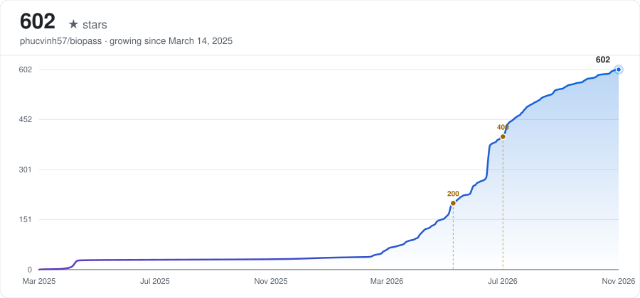

# Biopass - An alternative to Howdy

    

    
    
    

<b>Modern multi-modal biometric login for Linux - face and fingerprint, with GUI management.</b>

---

## Why Biopass?

Linux lacks a unified, modern equivalent of Windows Hello. Biopass, by [@phucvinh57](https://github.com/phucvinh57) and [@thaitran24](https://github.com/thaitran24), fills that gap.

## Comparison

| Feature | [**Biopass**](https://github.com/phucvinh57/biopass) | [**Howdy**](https://github.com/boltgolt/howdy) |
| :--- | :--- | :--- |
| **Authentication methods** | Face + Fingerprint | Face only |
| **User Interface** | Modern GUI for management | Command-line interface only |
| **Configuration** | GUI | Manual |
| **Face Anti-spoofing** | IR camera + Embedded AI model | IR camera only |

## About AI contribution

I have seen some user feedback that they do not want to install an AI slop on their machine. I have no idea how they determine a project is a slop. 

I started this project in 2024, before coding agents existed. I learned PAM, Tauri, face recognition and antispoofing, study CMake and Linux packaging by hand to build it. This is the most interesting project that I have built, at least until now.

However, I reach my limit so fast:
- **Hardware**: Cameras vary widely (some work with `v4l2` but not `libcamera`, and vice versa), and I do not own most of them. Bug reports are often hard to reproduce, so fixes used to mean guessing, shipping a release candidate, and asking users to retest. Claude and Codex know a lot about these devices that I do not.
- **Time**: Life is difficult. I am just a regular person who is trying to survive. I have other things to do.

That is why I adopt AI to help maintain this project. If you do not want to use it just because Claude or Codex is in the contributor list, I do not care. To keep quality up, I follow [Addy Osmani's article](https://x.com/addyosmani/article/2114604912520921136).

## Installation

- Debian and RPM packages: https://github.com/phucvinh57/biopass/releases
- AUR: https://aur.archlinux.org/packages/biopass-bin

Setup guides:
- PAM (system sign-in, `pam-auth-update` on Debian/Ubuntu): [docs/PAM.md](docs/PAM.md)
- Polkit (interactive authentication): [docs/Polkit.md](docs/Polkit.md)
- IR camera: [docs/IR camera.md](docs/IR%20camera.md)
- Keyring/KWallet unlock after face login (TPM-sealed password): [docs/Keyring.md](docs/Keyring.md)

## Features

- [x] Authentication: register multiple biometrics, run methods in parallel or sequentially.
    - [x] Face:
      - [x] Recognition
      - [x] Anti-spoofing
        - [x] With AI model
        - [x] With IR camera
    - [x] Fingerprint
- [x] Local AI model management: download, update, and delete models.

Bugs and feature requests: open an issue. To contribute, read [CONTRIBUTING.md](CONTRIBUTING.md).

## References
Models used in this project:
- Face Recognition: **[EdgeFace](https://github.com/otroshi/edgeface)**
- Face Detection: **[YOLO-Face](https://github.com/akanametov/yolo-face)**

## Star History

<picture>
  <source media="(prefers-color-scheme: dark)" srcset="assets/star-history-dark.svg" />
  <source media="(prefers-color-scheme: light)" srcset="assets/star-history-light.svg" />
  
</picture>
