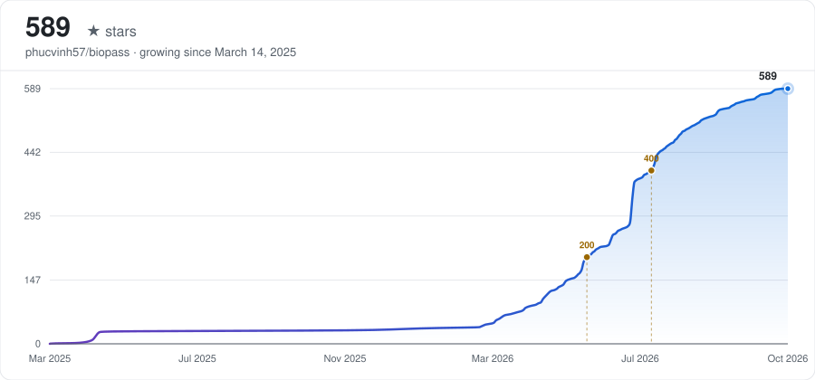

# Biopass - An alternative to Howdy

    

    
    
    

<b>Modern multi-modal biometric login for Linux — face and fingerprint, with GUI management.</b>

---

## Why Biopass?

Linux lacks a unified, modern equivalent of Windows Hello. Biopass, by [@phucvinh57](https://github.com/phucvinh57) and [@thaitran24](https://github.com/thaitran24), fills that gap.

## Comparison

| Feature | [**Biopass**](https://github.com/phucvinh57/biopass) | [**Howdy**](https://github.com/boltgolt/howdy) |
| :--- | :--- | :--- |
| **Authentication methods** | Face + Fingerprint | Face only |
| **User Interface** | Modern GUI for management | Command-line interface only |
| **Configuration** | GUI | Manual |
| **Face Anti-spoofing** | IR camera + Embedded AI model | IR camera only |

## Installation

- Debian and RPM packages: https://github.com/phucvinh57/biopass/releases
- AUR: https://aur.archlinux.org/packages/biopass-bin

Setup guides:
- PAM (system sign-in, `pam-auth-update` on Debian/Ubuntu): [docs/PAM.md](docs/PAM.md)
- Polkit (interactive authentication): [docs/Polkit.md](docs/Polkit.md)
- IR camera: [docs/IR camera.md](docs/IR%20camera.md)
- Keyring/KWallet not unlocked after face login: [docs/Keyring.md](docs/Keyring.md)

## Features

- [x] Authentication: register multiple biometrics, run methods in parallel or sequentially.
    - [x] Face:
      - [x] Recognition
      - [x] Anti-spoofing
        - [x] With AI model
        - [x] With IR camera
    - [x] Fingerprint
- [ ] Local AI model management: download, update, and delete models.

Bugs and feature requests: open an issue. To contribute, read [CONTRIBUTING.md](CONTRIBUTING.md).

## References
Models used in this project:
- Face Recognition: **[EdgeFace](https://github.com/otroshi/edgeface)**
- Face Detection: **[YOLO-Face](https://github.com/akanametov/yolo-face)**

## Star History

<picture>
  <source media="(prefers-color-scheme: dark)" srcset="assets/star-history-dark.svg" />
  <source media="(prefers-color-scheme: light)" srcset="assets/star-history-light.svg" />
  
</picture>
